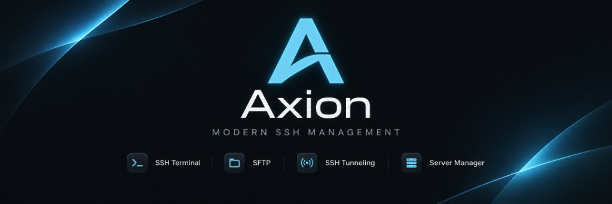
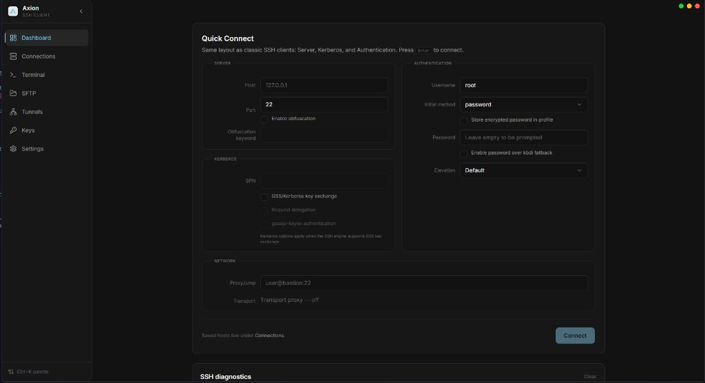
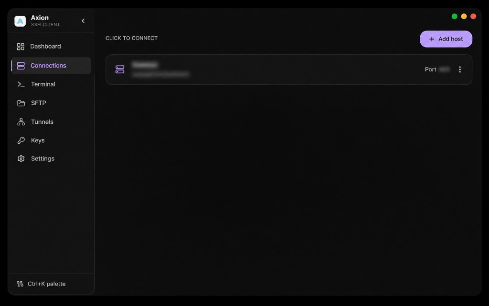
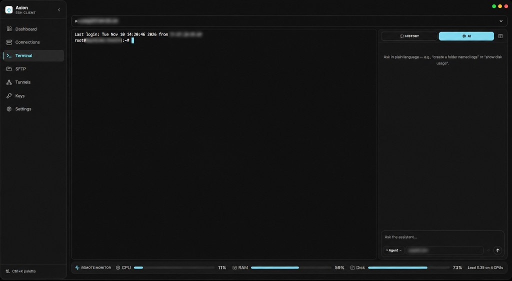
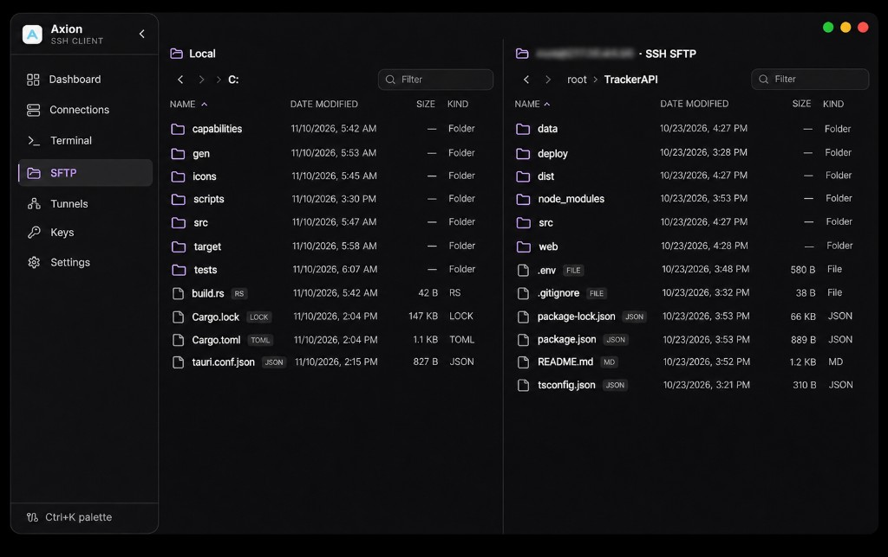
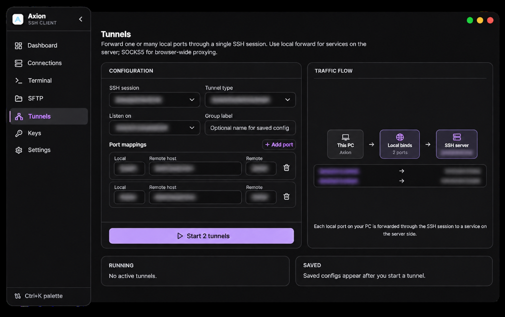
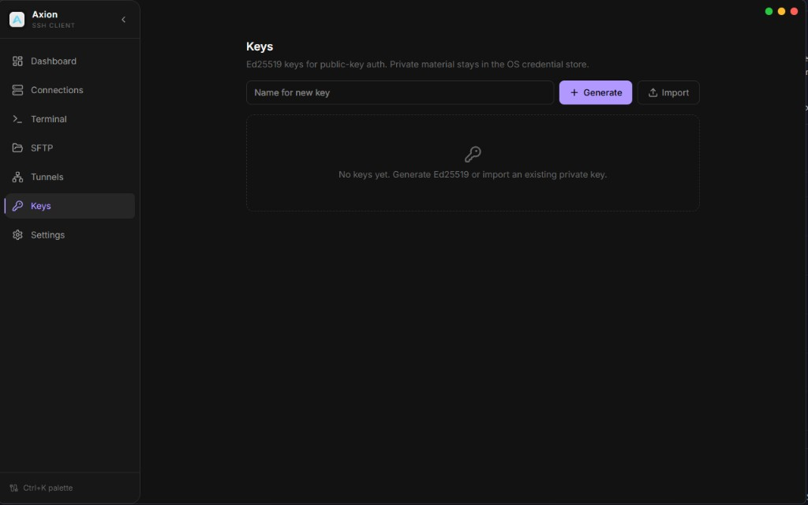

<p align="center">
  
</p>

<h1 align="center">Axion</h1>

<p align="center">
  <strong>A native SSH workspace for Windows and Linux.</strong><br />
  Terminals, files, tunnels, keys, and optional AI assistance — in one desktop app.
</p>

<p align="center">
  <a href="https://github.com/4m1rali/Axion">Repository</a>
  ·
  <a href="#installation">Install</a>
  ·
  <a href="#screenshots">Screenshots</a>
  ·
  <a href="LICENSE">MIT License</a>
</p>

<p align="center">
  
  
  
  
</p>

---

## Table of contents

- [Overview](#overview)
- [Who it is for](#who-it-is-for)
- [Features](#features)
- [Terminal AI](#terminal-ai)
- [Security & privacy](#security--privacy)
- [Screenshots](#screenshots)
- [Installation](#installation)
- [Development](#development)
- [License](#license)

---

## Overview

**Axion** is a desktop SSH client built for operators and developers who live in remote shells. Instead of juggling a terminal emulator, an SFTP client, a tunnel manager, and another tool for keys, Axion keeps the full session lifecycle in a single **Tauri 2** application: connect from the dashboard, work in a full **xterm.js** terminal, browse files over **SFTP**, manage **port forwarding**, and—when you opt in—ask an **LLM assistant** to run **Linux commands on the active SSH session**.

The SSH stack runs in **Rust** ([russh](https://github.com/warp-tech/russh)); the interface is **React**, **TypeScript**, and **Tailwind CSS 4**, with multilingual UI (including **RTL**), themes, and a **Ctrl+K** command palette.

Axion is aimed at **daily production use**: quick connect with classic server / auth / Kerberos / proxy fields, saved **Connections** profiles, host-key verification, credential storage in the **Windows credential store** where available, and live **CPU / RAM / disk / load** bars for the remote host under your terminal.

---

## Who it is for

| Audience | How Axion helps |
| :--- | :--- |
| **SRE / DevOps** | Many servers, tunnels, jump hosts, and metrics without leaving one window. |
| **Backend developers** | Terminal + SFTP + history in one place; optional AI for repetitive remote checks. |
| **Windows-first teams** | Native app—not WSL required to get a serious SSH workflow on the desktop. |
| **Security-conscious users** | Explicit host-key prompts; destructive remote commands require **Allow & run** in Agent mode. |

---

## Features

| Module | Description |
| :--- | :--- |
| **Dashboard** | **Quick Connect** — host (e.g. `127.0.0.1`), port, username, password / key methods, Kerberos, jump host, transport proxy, optional obfuscation. |
| **Connections** | Save profiles, reconnect in one click, import-friendly host labels. |
| **Terminal** | PTY over SSH, search, reconnect shortcut, per-server **command history** and **ghost hints**, **resizable History \| AI** side panel, **remote monitor** footer. |
| **Terminal AI** | OpenAI-compatible API; **Agent** (runs safe commands on SSH) or **Ask** (chat only). See [Terminal AI](#terminal-ai). |
| **LLM settings** | Provider URL, key in secure storage, model picker, last request + token usage (local telemetry). |
| **SFTP** | Dual-pane local/remote browser, filters, session-linked hosts. |
| **Tunnels** | Local / remote / SOCKS-style forwarding, visual flow, port mapping groups. |
| **Keys** | Ed25519 generate & import for public-key auth. |
| **Settings** | Accent color, light/dark theme, language, notifications, LLM, terminal behavior, link to this repo on GitHub. |

---

## Terminal AI

Axion’s assistant is **scoped to the SSH session**, not your Windows PC.

- **Remote-only** — System prompt and command sanitizer enforce **Linux/POSIX** on the connected server; local PowerShell/CMD suggestions are stripped.
- **Agent mode** — Model returns `commands` blocks; safe lines run automatically; output is captured from the PTY and fed back for multi-step tasks (with step limits). The model is nudged to **summarize results in chat** after each run.
- **Ask mode** — Guidance and command examples without auto-execution (except dangerous lines still show **Allow & run** if you choose to run them).
- **Safety** — Destructive patterns (`rm`, `find -delete`, `shutdown`, pipes to `sh`, etc.) require **Allow & run**; other commands run without extra clicks in Agent mode.
- **Context** — Working directory is inferred from the shell prompt when possible; the model prefers `find .` and relative work from that cwd.
- **Privacy** — Only messages you type in the AI panel are sent to your LLM provider; SSH traffic is not bulk-uploaded by default.

Configuration: **Settings → LLM** → enable, API URL + key → pick a model → **Terminal** → side panel **AI**. Prompt source: `src/lib/llm/axionTerminalPrompt.md`.

---

## Security & privacy

- **Host keys** — Unknown or changed keys trigger an explicit trust dialog before the session proceeds.
- **Secrets** — API keys and profile passwords use OS-backed storage where the platform supports it.
- **AI approvals** — High-impact shell commands need user confirmation.
- **LLM** — You choose provider and model; telemetry for last request/usage stays **local** in the app settings UI.
- **In-app updates** — Installed builds compare your version to the latest [GitHub Release](https://github.com/4m1rali/Axion/releases); updates download the published **NSIS `.exe`** over HTTPS. This does **not** use minisign / `latest.json` (simpler CI, no repo signing secrets). Run the installer when prompted; close Axion first if the setup asks you to.

---

## Screenshots

Click a section to expand. Images are stored under `assets/screenshots/`.

<details>
<summary><strong>Dashboard — Quick Connect</strong></summary>
<br />
<p align="center">
  
</p>
<p align="center">
  <sub>Server, authentication, Kerberos, and network in one card — example host <code>127.0.0.1</code>, port <code>22</code>.</sub>
</p>
</details>

<details>
<summary><strong>Connections</strong></summary>
<br />
<p align="center">
  
</p>
<p align="center">
  <sub>Profiles for repeat hosts; connect or edit from a single list.</sub>
</p>
</details>

<details>
<summary><strong>Terminal AI — Agent</strong></summary>
<br />
<p align="center">
  
</p>
<p align="center">
  <sub>Resizable AI side panel on an active SSH session — Agent mode, model picker, and remote monitor (CPU, RAM, disk, load).</sub>
</p>
</details>

<details>
<summary><strong>SFTP</strong></summary>
<br />
<p align="center">
  
</p>
<p align="center">
  <sub>Local and remote trees, breadcrumbs, and quick filtering.</sub>
</p>
</details>

<details>
<summary><strong>Tunnels</strong></summary>
<br />
<p align="center">
  
</p>
<p align="center">
  <sub>Port mappings and traffic visualization over the active SSH session.</sub>
</p>
</details>

<details>
<summary><strong>Keys</strong></summary>
<br />
<p align="center">
  
</p>
<p align="center">
  <sub>Generate or import Ed25519 keys for authentication.</sub>
</p>
</details>

---

## Installation

### End users

1. Download from [GitHub Releases](https://github.com/4m1rali/Axion/releases/latest):
   - **Windows** — `.exe` (NSIS) or `.msi`
   - **Linux (Debian/Ubuntu/Mint, etc.)** — `.deb` or `.AppImage` when published by CI
   - **Arch / Manjaro** — `.AppImage` or `axion-linux-x86_64-gnu.tar.gz` when published by CI, or build from source
2. Install or run the bundle for your OS.
3. Open **Dashboard**, enter host (e.g. `127.0.0.1`), user, and auth method → **Connect**.

OS-specific Settings (Windows account photo, Credential Manager labels) are **skipped automatically** on Linux — SSH, terminal, SFTP, and tunnels work the same.

### Updates (installed app)

Production builds poll the GitHub **Releases** API about once a minute. If a **newer tag** exists (for example you are on `v0.1.4` and `v0.1.5` is published), a banner appears at the bottom-left.

| Action | Behavior |
| :--- | :--- |
| **Install** | Downloads the right asset (`.exe` / `.deb` / `.AppImage` by OS), starts it, and exits Axion. |
| **Later** | Dismisses the banner for that version until you restart the app. |

Update checks run only in **release** installs (`pnpm tauri build`), not in `pnpm tauri dev`. You must be on an **older** version than the latest release to see the banner.

CI on **`main`** publishes **`v{version}`** with Windows and Linux assets (GitHub Releases API updater — no signing secrets).

### Build from source

**Prerequisites:** [Node.js](https://nodejs.org/) LTS, [pnpm](https://pnpm.io/), [Rust](https://www.rust-lang.org/tools/install), and [Tauri platform deps](https://v2.tauri.app/start/prerequisites/).

**Debian / Ubuntu / Mint:**

```bash
sudo apt install libwebkit2gtk-4.1-dev libappindicator3-dev librsvg2-dev patchelf
git clone https://github.com/4m1rali/Axion.git
cd Axion
pnpm install
pnpm tauri dev    # or: pnpm tauri build
```

**Arch / Manjaro** (build only):

```bash
sudo pacman -S --needed base-devel webkit2gtk-4.1 gtk3 libappindicator-gtk3 librsvg openssl patchelf
git clone https://github.com/4m1rali/Axion.git
cd Axion
pnpm install
pnpm tauri build --bundles appimage
```

On Arch, **`.deb` bundles are not produced** (use AppImage or the release binary tarball). Package names follow [Tauri 2 prerequisites](https://v2.tauri.app/start/prerequisites/).

| Command | Purpose |
| :--- | :--- |
| `pnpm dev` | Frontend only (Vite) |
| `pnpm build` | Typecheck + production frontend |
| `pnpm tauri build` | Release desktop binary |

**CI:** [`.github/workflows/build-windows.yml`](.github/workflows/build-windows.yml) (MSI + EXE), [`.github/workflows/build-linux.yml`](.github/workflows/build-linux.yml) (Debian `.deb` + AppImage on Ubuntu 22.04, AppImage + tarball on Arch).

Bump **`version`** in `package.json`, `src-tauri/tauri.conf.json`, and `src-tauri/Cargo.toml` before shipping so releases and in-app version checks stay aligned.

---

## Development

- **Structure** — `src/` React app; `src-tauri/` Rust commands and SSH session logic.
- **i18n** — Strings under `src/lib/i18n/` (multiple locales, RTL-capable).
- **Contributing** — Fork → branch → PR; keep commits focused; MIT license.
- **Do not commit** — `node_modules/`, `dist/`, `src-tauri/target/`, `.env` (see `.gitignore`).
- **Updater code** — `src/lib/appUpdate.ts` (GitHub API) and `src-tauri/src/app_update.rs` (`install_release_update` command).

---

## License

Axion is released under the **[MIT License](LICENSE)**.

Copyright (c) 2026 [4m1rali](https://github.com/4m1rali).

---

<p align="center">
  <strong>Axion</strong> · Modern SSH Management for Windows<br />
  <a href="https://github.com/4m1rali/Axion">github.com/4m1rali/Axion</a>
</p>
